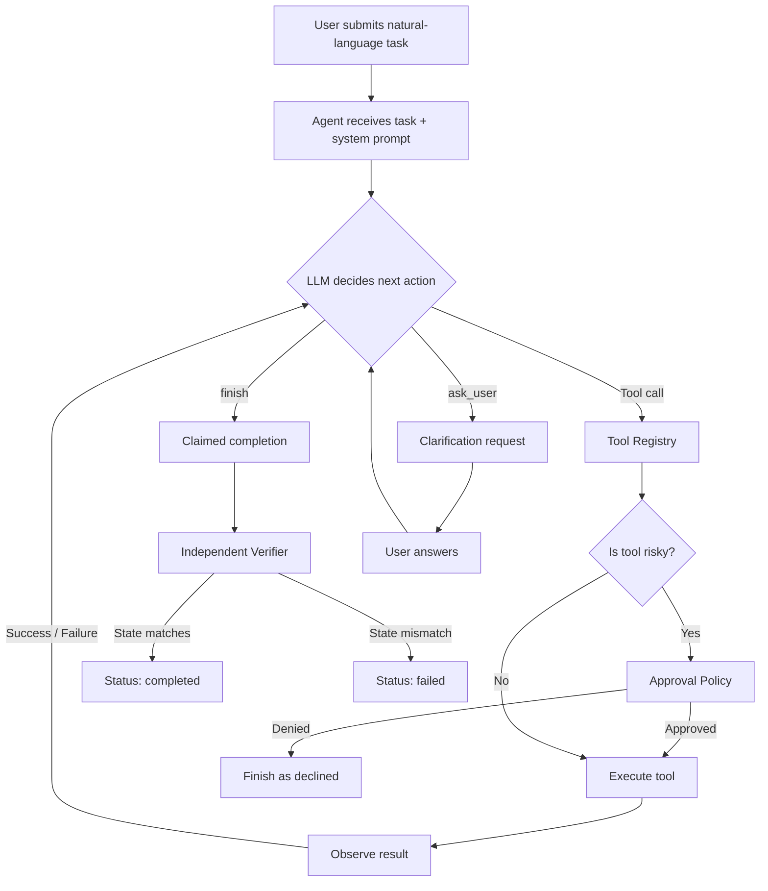
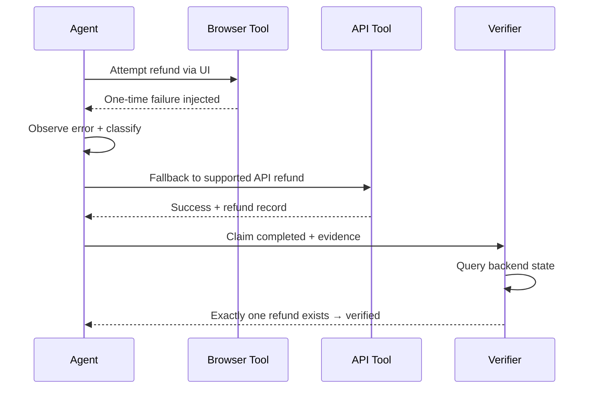
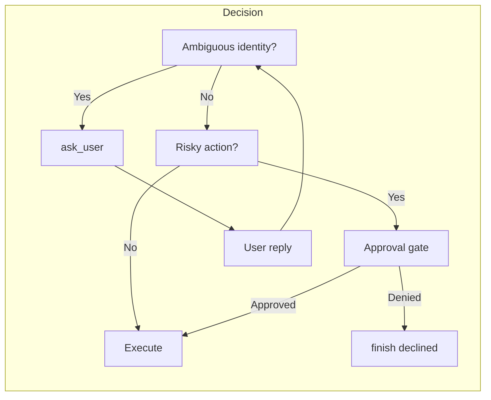

# Autonomous AI Task Worker

> **CentrAlign AI — AI Engineering Intern Submission**  
> Prototype of an AI worker that accepts a natural-language business objective and autonomously plans, executes, recovers from failures, seeks clarification/approval when needed, and verifies outcomes against real application state.

**Repository:** [MitadruMridha05/Autonomous_AI_Task_Worker](https://github.com/MitadruMridha05/Autonomous_AI_Task_Worker)

**Demo Video:** [Watch on Google Drive](https://drive.google.com/file/d/1hwm4w6L7yWUNmngSRFPJ8r4nFLyqVC1Q/view?usp=drive_link)

---

## Table of Contents

- [Problem Statement](#problem-statement)
- [Solution Overview](#solution-overview)
- [Architecture](#architecture)
- [Workflow Diagrams](#workflow-diagrams)
- [Key Capabilities](#key-capabilities)
- [Tech Stack](#tech-stack)
- [Setup & Run Instructions](#setup--run-instructions)
- [Demo Scenarios](#demo-scenarios)
- [Evaluation & Reliability](#evaluation--reliability)
- [Screenshots](#screenshots)
- [Important Design Decisions](#important-design-decisions)
- [Assumptions](#assumptions)
- [Known Limitations](#known-limitations)
- [What I Would Build Next](#what-i-would-build-next)
- [Models, Frameworks & External Services](#models-frameworks--external-services)
- [License](#license)

---

## Problem Statement

Companies perform many repetitive tasks that involve reading information, deciding what to do next, using websites or applications, and checking whether the task was completed correctly.

Today a person often has to manually move between different tools to complete even a simple request.

**Goal of this prototype:**  
Build an AI worker that can take a natural-language task and autonomously attempt to complete it using a computer (browser + APIs + mock internal system).

Example task:
> “Priya Sharma got a damaged item. Find her latest order, check refund eligibility, refund it if eligible, notify the customer, and verify the final state.”

The system must:
- Understand the end goal (not just follow a rigid script)
- Break the request into actions
- Use tools (browser, APIs, files)
- Observe results and decide the next step
- Remember relevant information
- Detect failures and attempt reasonable recovery
- Verify the actual outcome against backend state
- Ask for clarification or human approval when it cannot safely proceed
- Return a concise summary + evidence

---

## Solution Overview

This project implements a **narrow but genuine autonomous loop** inside a simulated company environment (OpsPilot):

1. User submits a natural-language objective via the `/worker` dashboard or CLI.
2. The **Agent** (LLM + tool registry) plans and executes tool calls.
3. Tools include:
   - Browser automation (Playwright)
   - Direct REST APIs against the mock company backend
   - File export (CSV invoices)
4. Every tool result is observed; the agent decides the next action.
5. **Safety controls**:
   - Clarification (`ask_user`) on ambiguity
   - Human approval gate for risky actions (refunds, outbound messages)
6. **Verification**: After the agent claims “completed”, an independent verifier checks the real SQLite / API state.
7. Full execution traces are persisted as JSON for inspection and evaluation.

A **working narrow prototype** (customer / order / refund / invoice workflows) is prioritised over a broad but mocked system.

---

## Architecture

```
┌─────────────────────────────────────────────────────────────┐
│                     User Interface                           │
│  React + TypeScript Dashboard  (/worker)  +  CLI             │
└────────────────────────┬────────────────────────────────────┘
                         │ HTTP / CLI
┌────────────────────────▼────────────────────────────────────┐
│                   FastAPI Backend (app/)                      │
│  • Mock company APIs (customers, orders, refunds, invoices)  │
│  • Worker adapter  (/api/worker/run …)                       │
│  • Serves built frontend                                     │
└────────────────────────┬────────────────────────────────────┘
                         │
┌────────────────────────▼────────────────────────────────────┐
│                     Agent Core (agent/)                       │
│                                                              │
│  LLM Client  ──►  Agent Loop  ──►  Tool Registry             │
│       │                 │                 │                  │
│       │                 │                 ├─ Browser tools   │
│       │                 │                 ├─ API tools       │
│       │                 │                 ├─ Control tools   │
│       │                 │                 │  (finish, ask)   │
│       │                 ▼                 │                  │
│       │          Approval Policy          │                  │
│       │          + Verifier               │                  │
│       └────────── Trace + RunResult ──────┘                  │
└─────────────────────────────────────────────────────────────┘
                         │
          ┌──────────────┼──────────────┐
          ▼              ▼              ▼
     SQLite DB      Playwright      Runs / Evals
   (mock company)   (browser)     (traces, reports)
```

### Core Loop (simplified)

```
task → [LLM decides] → tool call(s)
       ↓
  [guard / registry executes]
       ↓
  result back to LLM → … until finish
       ↓
  independent verifier against backend state
```

---

## Workflow Diagrams

### High-level Agent Execution Flow



### Failure Recovery Path (Browser → API)



### Safety & Human-in-the-Loop



---

## Key Capabilities

| Capability              | Implementation                                                                 |
|-------------------------|--------------------------------------------------------------------------------|
| Autonomy                | LLM decides next tool / finish without step-by-step instructions               |
| Execution               | Real browser (Playwright) + real API calls against local mock company          |
| Reliability             | Failure classification, one-time browser failure → API fallback, retries       |
| Verification            | Independent backend-state check after `finish` (not just model claim)          |
| Clarification           | `ask_user` control tool when identity / intent is ambiguous                    |
| Human approval          | Configurable policy for refunds & outbound messages                            |
| Observability           | Full JSON traces, live activity timeline in dashboard, evaluation reports      |
| Evaluation              | 9 deterministic scenarios + optional live-provider evals + pytest suite        |

---

## Tech Stack

- **Language:** Python 3.11+
- **Backend:** FastAPI + SQLite (mock company)
- **Agent:** Custom loop (`agent/core/loop.py`) + tool registry
- **LLM:** OpenAI-compatible providers (configurable via `.env`)
- **Browser:** Playwright (Chromium)
- **Frontend:** React + TypeScript + Vite (served at `/worker`)
- **Evaluation:** Custom harness + MLflow (optional) + Pandas/Seaborn reports
- **CI / Reproducibility:** GitHub Actions, DVC pipeline, Docker Compose
- **Testing:** pytest (59+ tests including browser-to-API recovery)

---

## Setup & Run Instructions

### Prerequisites
- Python 3.11+
- Node.js 18+ (for frontend build)
- Playwright browsers (`python -m playwright install chromium`)

### 1. Clone & Install

```bash
git clone https://github.com/MitadruMridha05/Autonomous_AI_Task_Worker.git
cd Autonomous_AI_Task_Worker

python -m venv .venv
source .venv/bin/activate          # Windows: .\.venv\Scripts\Activate.ps1

pip install --upgrade pip
pip install -r requirements.txt
python -m playwright install chromium
```

### 2. Environment

```bash
cp .env.example .env
# Edit .env only if you want a live LLM provider.
# Offline deterministic evaluations work without any API key.
```

### 3. Build Frontend & Start Server

```bash
npm --prefix frontend install
npm --prefix frontend run build

uvicorn app.main:app --reload --port 8000
```

Open the dashboard: **http://localhost:8000/worker**

### 4. Optional CLI Run

```bash
python -m agent.cli --auto-approve \
  "Priya Sharma got a damaged item. Refund her latest order and let her know."
```

(`--auto-approve` bypasses the human approval gate — use only in the local demo environment.)

### 5. Run Tests & Evaluation

```bash
pytest -q
python -m evals.run_evals
python -m evals.report
```

Artifacts appear under `runs/`.

### 6. Docker (optional)

```bash
cd docker
docker compose up --build app
```

---

## Demo Scenarios

Paste any of these into the `/worker` task field:

**Normal task (primary)**
```
Priya Sharma got a damaged item. Find her latest order, check its current status and refund eligibility, refund it if eligible, notify the customer, and verify the final order and refund state. If any required detail is ambiguous or the action needs approval, stop and ask rather than guessing.
```

**Browser failure → API recovery**
```
Find the eligible order for Priya Sharma and process the refund. If the browser action fails, inspect the error, decide whether a safe fallback is available, use the supported API fallback if appropriate, and verify that exactly one refund record exists.
```

**Ambiguous identity**
```
Find the customer named John and refund his order. If more than one customer matches, do not choose one. Ask me which customer or order I mean.
```

**Risky action + approval**
```
Inspect Priya Sharma's latest order and determine whether it qualifies for a refund. Before issuing a refund or sending an outbound customer message, pause for explicit human approval.
```

**Invoice CSV export**
```
Find all invoices that are more than 30 days overdue, export the matching records to a CSV file, and report the output path and number of records. Verify that the file exists.
```

---

## Evaluation & Reliability

- **Deterministic suite:** 9 scenarios covering happy path, failure injection, ambiguity, approval, no-op, invoice export, etc. (scripted model turns + real backend checks).
- **Live evaluation:** Optional (`python -m evals.run_live_evals --model …`) when a provider key is configured.
- **Browser recovery test:** `pytest tests/test_browser_api_recovery.py` injects a one-time UI failure and asserts the API fallback + verifier succeed.
- **CI:** GitHub Actions runs imports, pytest, evals and report generation.
- **Traces:** Every run writes a detailed JSON trace under `runs/` that can be inspected or fed into MLflow.

---

## Important Design Decisions

1. **Generic agent loop** – Domain knowledge lives only in tools and the system prompt. The loop itself knows nothing about refunds or customers.
2. **Tool results never crash the loop** – Failures are returned as structured `ToolResult` objects so the LLM can observe and recover.
3. **Independent verification** – A model saying “done” is insufficient. A separate verifier queries the real backend state before a run is marked successful.
4. **Approval as a first-class control** – Risky tools go through an explicit policy; the agent cannot bypass it.
5. **Narrow but real environment** – A seeded SQLite company (customers, orders, refunds, invoices) + Playwright browser + REST APIs gives genuine execution instead of pure mocks.
6. **Full observability** – Every LLM turn, tool call, approval and verification event is recorded in a trace that the dashboard and evaluation harness consume.
7. **Deterministic evaluation first** – Scripted model turns + ground-truth checks make the suite reproducible and CI-friendly; live LLM runs are optional.

---

## Assumptions

- The prototype operates against a **local mock company** (no real customer data or production systems).
- Browser automation is limited to the pages and flows present in the mock UI.
- A live LLM provider is optional; the evaluation suite works offline with scripted responses.
- Human approval is interactive in the dashboard / CLI; `--auto-approve` is only for demos.
- The current tool set is intentionally narrow (customer/order/refund/invoice) so that autonomy and verification can be demonstrated reliably.

---

## Known Limitations

- Supports only the workflows implemented in the mock company (refunds, notifications, overdue-invoice export).
- Browser coverage is not universal; recovery currently focuses on a documented one-time UI failure path.
- In-process run history (not a persistent job queue).
- Live multi-step browser navigation beyond the seeded pages is limited.
- Docker image build was validated in configuration but should be re-tested on the target machine.
- No multi-agent collaboration or long-term memory across runs yet.

---

## What I Would Build Next

If given additional time I would prioritise:

1. **Persistent memory & session state** across related tasks.
2. **Broader tool surface** (email, Slack, more internal systems) with the same safety & verification patterns.
3. **Stronger failure taxonomy + automatic retry policies** with exponential back-off and circuit breakers.
4. **Production-grade job queue** (Celery / Redis / Temporal) instead of in-process runs.
5. **Richer evaluation** – adversarial tasks, cost/latency metrics, and continuous live-provider scoring.
6. **Human feedback loop** – allow operators to correct traces and fine-tune or few-shot the agent.
7. **Security & multi-tenancy** – sandboxing of browser sessions, credential isolation, audit logging.

---

## Models, Frameworks & External Services

| Component              | Choice                                      |
|------------------------|---------------------------------------------|
| LLM                    | Any OpenAI-compatible provider (configurable) |
| Agent orchestration    | Custom Python loop (no LangChain / CrewAI)  |
| Backend                | FastAPI + SQLite                            |
| Browser automation     | Playwright                                  |
| Frontend               | React + TypeScript + Vite                   |
| Evaluation             | Custom harness + optional MLflow            |
| CI                     | GitHub Actions                              |
| Reproducibility        | DVC + Docker Compose                        |
| AI coding assistance   | Cursor / Claude / ChatGPT (used for speed; all design decisions and final code understood and owned by me) |

---

## License

This repository is submitted as part of the CentrAlign AI Engineering Internship application.  
All code is original work for evaluation purposes.

---

**Thank you for reviewing the submission.**  
I am happy to walk through the architecture, debug any scenario live, or extend the prototype during the technical discussion.
