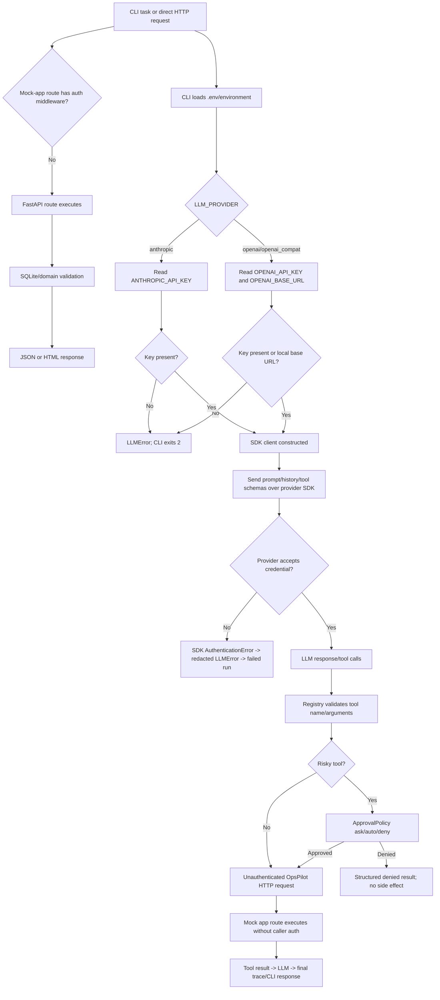

# Authentication and Credential-Handling Audit

**Repository:** `MitadruMridha05/Autonomous_AI_Task_Worker`  
**Audit scope:** repository at commit inspected on branch `audit/authentication-credential-handling`  
**Conclusion:** the repository does **not implement authentication for users or clients of the mock application**. It implements only outbound authentication to optional LLM providers, using provider API keys loaded from environment variables. The agent's approval policy is a safety/consent gate, not identity authentication or a general authorization system.

## Executive summary

| Area | Finding | Severity |
|---|---|---:|
| Mock app user authentication | No login route, password validation, session, cookie, bearer/API-key middleware, OAuth, JWT, or FastAPI auth dependency exists. All REST and HTML business routes are reachable without credentials. | High for any non-local deployment |
| LLM provider authentication | Anthropic and OpenAI-compatible clients receive API keys from environment variables. Missing keys fail closed before a live call. | Low/acceptable for local demo; provider secret handling remains operationally sensitive |
| Agent authorization | Risky tools require `ApprovalPolicy`; invalid tool arguments are rejected before execution. `--auto-approve` intentionally bypasses the interactive approval prompt. | Medium: consent control, not account authorization |
| Credential lifecycle | No access-token, refresh-token, session-token, or invalidation lifecycle exists. Provider keys are read at client construction and held by the SDK client for the process lifetime. | Informational |
| Leakage | Provider keys are not included in normal traces or CLI output. However, traces and CLI events are not redacted and can contain task text, tool arguments, tool results, customer data, or any secret a user puts into a task/record. Provider `APIError` text is wrapped and may contain provider-returned details. | Medium |

## Components and precise code paths

### Application/API surface

- `app/main.py:41` creates the FastAPI app.
- `app/main.py:58-117` registers `/api/*` routes. `api_health`, customer/order/invoice/audit reads, refund, notification, and reset have no `Depends` authentication dependency and no middleware.
- `app/main.py:120-169` registers the HTML routes. These also have no authentication dependency or session check.
- `app/main.py:44-49` `get_db()` only opens/closes SQLite connections; it does not authenticate a caller.
- `app/services.py:95-143` enforces domain rules such as order existence, delivered status, duplicate-refund prevention, and amount limits. These are business invariants, not caller permissions. `actor="api"` or `actor="ui"` is a caller label supplied by the route, not an authenticated principal.
- `app/services.py:28-32` writes audit records, but the audit log records the unauthenticated route label and does not prove user identity.

### CLI and agent surface

- `agent/cli.py:66-121` accepts a task and local command flags. It has no login or credential prompt. `--auto-approve` is a local operator choice, not authentication.
- `agent/core/loop.py:86-146` runs the task loop. It calls the LLM, then `_handle_call()` at `149-189`.
- `agent/core/loop.py:170-183` validates risky tool arguments, invokes `ApprovalPolicy.approve()`, and executes only if approved. Non-risky tools execute after registry validation.
- `agent/tools/registry.py:37-65` validates Pydantic arguments and converts unknown tools, validation failures, `ToolError`, and unexpected tool exceptions into structured results. It does not authenticate the model or caller.
- `agent/core/guard.py:15-27` supports `ask`, `auto`, and `deny`. This is a human-in-the-loop authorization/consent mechanism for risky operations, with no identity, role, or permission database.
- `agent/tools/api_client.py:18-33` sends unauthenticated HTTP requests to the mock app. It does not set `Authorization`, cookies, API keys, or client certificates.

### Provider credential components

- `agent/config.py:9-15` calls `load_dotenv(override=False)` and reads `OPSPILOT_URL`; it does not retrieve secrets from a vault.
- `.env.example:1-12` documents `ANTHROPIC_API_KEY`, `OPENAI_API_KEY`, provider/model settings, and optional base URLs. `.env` is ignored by `.gitignore`.
- `agent/core/llm.py:181-197` `make_llm()` reads `LLM_PROVIDER`, `LLM_MODEL`, `ANTHROPIC_API_KEY`, `OPENAI_API_KEY`, and `OPENAI_BASE_URL` from `os.environ`.
- `agent/core/llm.py:89-109` `AnthropicLLM.__init__()` passes the key to `anthropic.Anthropic(api_key=api_key)`. `generate()` sends the system prompt, conversation history, and tool schemas through `messages.create()`.
- `agent/core/llm.py:158-177` `OpenAICompatLLM.__init__()` passes the key and optional base URL to `openai.OpenAI(...)`. `generate()` sends the translated prompt/history/tools through `chat.completions.create()`.
- `requirements.txt:11-12` declares `anthropic` and `openai`; there is no authentication framework dependency because the app has no user-auth feature.

## Authentication-flow diagram

## Request and credential flow

### Direct requests to the mock app

1. A caller sends an HTTP request to `/api/...` or `/customers...`.
2. FastAPI route matching occurs in `app/main.py`; there is no authentication middleware, security scheme, `Authorization` header check, session lookup, or caller principal creation.
3. `get_db()` opens SQLite.
4. The route calls `app.services` functions, which enforce input and domain invariants only.
5. The response is returned. For `DomainError`, `app/main.py:52-54` returns the domain status and message.

Therefore, missing, invalid, expired, and insufficient **application credentials have no distinct behavior**: credentials are neither required nor examined. A remote deployment would expose the full mock admin surface, including state-changing refund/notification endpoints and `/api/admin/reset`, unless an external reverse proxy supplies access control.

### CLI/agent requests

1. `agent.cli.main()` calls `load_env()` and parses the task.
2. It creates `OpsPilotClient(args.url)`, whose `_request()` performs ordinary HTTP requests with no auth headers or cookies.
3. `make_llm()` loads the selected provider key from the process environment and constructs an SDK client.
4. The agent loop sends the task/history/tool schemas to the provider.
5. The model's tool calls are validated by `ToolRegistry`; risky calls pass through `ApprovalPolicy` before `OpsPilotClient` executes them.
6. The mock app receives the request without authenticating the agent. Its `actor` field is hard-coded route metadata (`api`/`ui`).
7. Tool results and model responses return to the loop; the run trace is written under `runs/` unless `runs_dir=None`.

## Credential lifecycle

| Credential type | Obtained | Stored/loaded | Transmitted | Validated | Invalidated |
|---|---|---|---|---|---|
| Application user/API credential | Not implemented | None | None | None | None |
| Session cookie/token | Not implemented | None | None | None | None |
| OAuth/JWT/access token | Not implemented | None | None | None | None |
| Refresh token | Not implemented | None | None | None | None |
| Anthropic API key | Operator supplies environment/`.env` value | `load_dotenv()` then `os.getenv()`; passed into SDK object in `agent/core/llm.py:92-97` | SDK request to configured Anthropic endpoint | Provider validates it; SDK raises `AuthenticationError` | No application revocation or rotation; operator must remove/rotate it at provider and restart process |
| OpenAI-compatible API key | Operator supplies environment/`.env` value; local base URL may use sentinel `not-needed` | `make_llm()` then SDK object in `agent/core/llm.py:189-196` | SDK request to `OPENAI_BASE_URL` or SDK default | Provider validates it; SDK raises `AuthenticationError` | No application revocation or rotation; operator must remove/rotate it at provider and restart process |

Keys are not written to SQLite, run JSON, or Git by the implementation. The SDK owns its in-memory copy after construction. There is no refresh flow, expiration check, logout, revoke endpoint, or key rotation hook.

## Authentication vs authorization

They are separate in concept but only partially present in this repository:

- **Authentication:** absent for users/clients of OpsPilot. Provider authentication exists only as SDK-level API-key validation performed by Anthropic/OpenAI-compatible services.
- **Authorization/consent:** `ApprovalPolicy` gates tools marked `risky=True` (`issue_refund`, `send_customer_email`). Tool schema validation and business rules provide additional safety checks. These controls do not identify who approved an action, establish roles, or protect HTTP endpoints.
- **Domain checks:** duplicate refunds, order status, customer existence, and refund amount checks prevent invalid state transitions, but are not permissions.

## Failure cases

- Missing Anthropic key: `make_llm()` raises `LLMError` at `agent/core/llm.py:185-188`; CLI prints an actionable message and exits with code 2 (`agent/cli.py:92-95`).
- Missing OpenAI-compatible key: `make_llm()` raises at `agent/core/llm.py:190-195`, except a configured `OPENAI_BASE_URL` intentionally permits local/no-key operation using `"not-needed"`.
- Invalid/rejected provider key: `AnthropicLLM.generate()` and `OpenAICompatLLM.generate()` catch SDK `AuthenticationError` and raise a generic provider-specific `LLMError` without including the exception text (`llm.py:105-106`, `173-174`). The agent catches it at `loop.py:99-103`, emits an error event, and returns a failed run.
- Provider API error: `llm.py:107-108` and `175-176` include `str(exc)` in `LLMError`; provider error bodies can therefore reach the CLI/trace. No provider key is deliberately added, but this is a residual redaction risk.
- Missing/invalid app credentials: no failure; routes execute because no app authentication exists.
- Insufficient app permissions: no role/permission model exists. Risky actions are blocked only when the local approval policy denies them.
- Expired app credentials: not applicable because no app credentials exist. An expired provider key is expected to appear as provider authentication failure, but the application does not distinguish expired from otherwise invalid.
- HTTP 401/403 from a future/upstream API: `OpsPilotClient._to_error()` maps both to non-retryable `permission_denied` (`agent/tools/api_client.py:14-15`, `36-50`). This mapping exists for error taxonomy; the current mock app never emits these auth statuses.

## Leakage review

### Positive findings

- `.env` is ignored by `.gitignore`; only `.env.example` is tracked.
- No tracked credential-like files or hard-coded real-looking key literals were found in the source tree outside the vendored `myenv` directory.
- API keys are not interpolated into prompts, tool schemas, CLI status lines, trace events, or SQLite audit rows.
- Authentication exception messages deliberately use fixed remediation text instead of provider exception text.
- `agent/prompts/system_v1.md:13` explicitly treats tool-result text as data, not instructions, which reduces prompt-injection risk but is not credential protection.

### Residual risks

- `agent/core/loop.py:94-109, 149-195, 203` persists/prints task text, model text, tool arguments, tool results, and error previews without redaction. A secret included in a user task, customer record, or tool result could be written to `runs/*.json` or shown by `agent.cli.print_event()`.
- `agent/cli.py:44-50` prints every approval argument. This is appropriate for review but can expose sensitive business fields in terminal logs.
- Provider API error text is not normalized/redacted before being included in `LLMError` and a trace error event.
- `OPSPILOT_URL` is configurable and there is no allowlist/TLS enforcement in `OpsPilotClient`; a misconfigured URL can send task data and business data to an unintended HTTP service.
- The repository currently contains 745 tracked files under the vendored `myenv/` directory despite the `.gitignore` rule. It is not a runtime authentication module; removing it is a separate repository-hygiene change that should be reviewed independently.

## README requirements and authentication gaps

The README describes a mock “internal support and orders system,” a human approval gate, an LLM provider API key, and a login template in the aspirational structure (`README.md:116`), but the actual repository has no `app/templates/login.html` and no login implementation. The README does not specify a concrete user-authentication protocol, credential variables, roles, or protected endpoints. Consequently:

- Implementing a user-authentication system during this audit would invent requirements and change the project architecture.
- The correct finding is that application authentication is **missing**, not that it is implemented by a particular token mechanism.
- If the mock app is ever deployed beyond a trusted local/demo boundary, authentication and authorization become a required blocker before exposure.

## Safe automated tests added

`tests/test_authentication_audit.py` uses dummy provider keys and fake SDK/client objects only:

- provider rejects a dummy Anthropic credential -> generic error without provider exception text;
- provider rejects a dummy OpenAI-compatible credential -> generic error without provider exception text;
- upstream 401 and 403 responses -> non-retryable `permission_denied` mapping.

The existing suite already covers configured dummy-key client construction and missing-key/unknown-provider errors in `tests/test_llm_adapters.py:65-83`. There are intentionally no “valid app credential,” “missing app credential,” “expired session,” or “insufficient app role” tests because those application mechanisms do not exist; adding them would test an invented feature.

## Recommendations and remaining limitations

1. **Before non-local deployment:** put the app behind authenticated TLS, or implement an explicit auth layer with a documented identity provider, protected routes, roles, CSRF protections for HTML forms, secure cookies, and audit records tied to an authenticated subject.
2. Protect or disable `/api/admin/reset` outside test/demo mode.
3. Add structured redaction for task content, tool arguments/results, approval output, and provider exceptions before persistence or display.
4. Restrict `OPSPILOT_URL` to an approved HTTPS origin in deployed environments.
5. Add provider-key rotation/revocation operational procedures; the application has no token refresh or invalidation functionality.
6. Keep `.env`, `runs/`, and local databases out of commits; separately review removal of the already-tracked `myenv/` directory and use secret scanning in CI.

No application authentication code was added because the README does not require a specific protocol and the actual application is a local mock. The code change in this audit is test coverage plus this documentation.
